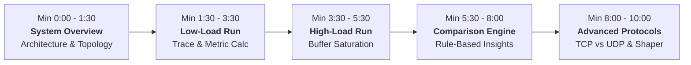

# EduNet Analyzer — College Demonstration Runbook (7–10 Minutes)

This document provides a step-by-step presentation script, technical explanations, command references, and defense points for demonstrating **EduNet Analyzer: University E-Learning Network Performance Simulator** in an academic or college viva examination.

---

## 1. Quick Launch Reference

### Prerequisite Environment
- **Operating System:** Windows 10/11 (with optional WSL2 Ubuntu for live NS-2)
- **Python:** Python 3.10+ (active virtualenv: `backend\venv\Scripts\python.exe`)
- **Node.js:** Node v18+ / v24+ (npm installed)

### How to Start the Application

#### Option A: Single Unified Production Server (Recommended)
FastAPI serves both the complete compiled React Single Page Application and the REST/WebSocket API on a single port:

```powershell
# 1. Reset to clean baseline state (seeds EXP-001 through EXP-008)
backend\venv\Scripts\python.exe reset_clean_state.py

# 2. Launch unified application on http://localhost:8000
backend\venv\Scripts\python.exe run.py
```
Open your browser and navigate to: **`http://localhost:8000`**

#### Option B: Dual Development Server (Fast HMR)
Run backend and frontend independently in two terminal windows:

**Terminal 1 (Backend API):**
```powershell
backend\venv\Scripts\python.exe run.py
# Backend runs on http://localhost:8000
```

**Terminal 2 (Frontend Vite Server):**
```powershell
npm --prefix frontend run dev
# Frontend runs on http://localhost:5173
```
Open your browser and navigate to: **`http://localhost:5173`**

---

## 2. Minute-by-Minute Demonstration Script (7–10 Minutes)



### Minute 0:00 – 1:30: System Overview & Academic Problem Context
1. **Open the Application:** Navigate to `http://localhost:8000`.
2. **Present the Problem Statement:**
   > *"Good morning professors. EduNet Analyzer investigates how concurrent student workloads affect network performance during peak university e-learning activities—such as video streaming, online examinations, and quiz submissions."*
3. **Show Dashboard Overview:**
   - Point out the **Header Status Pill**: Displays database status (`SQLite WAL Online`) and discrete-event engine mode (`Demo Mode` or `Live NS-2 WSL2`).
   - Point out the **Summary KPI Cards**: Total experiments, average throughput, average packet loss, average delay, and packet delivery ratio (PDR).
4. **Explain Network Topology (Navigate to "Network Topology" or show in New Simulation):**
   - Point out the realistic campus topology:
     $$\text{Student Nodes } (N) \xrightarrow{10\text{ Mbps Access}} \text{Router } R_1 \xrightarrow{\text{Bottleneck Core Link } (BW, \text{Delay})} \text{Router } R_2 \xrightarrow{100\text{ Mbps Core}} \text{LMS Server}$$

---

### Minute 1:30 – 3:30: Configure and Execute Low-Load Experiment
1. **Navigate to:** **`New Simulation`** (`/simulations/new`).
2. **Set Configuration Parameters:**
   - **Scenario Preset:** Click **"Low Traffic"** (or manually input):
     - **Student Clients:** `10`
     - **Bottleneck Bandwidth:** `1 Mbps` (or `512 Kbps`)
     - **Link Delay:** `20 ms`
     - **Simulation Duration:** `30 seconds` (or `10s` for quick demo)
     - **Transport Protocol:** `TCP (NewReno)`
     - **Experiment Name:** `Demo: Low Load Baseline`
3. **Execute Simulation:**
   - Click **`Run Simulation`**.
   - The UI automatically navigates to **Simulation Execution Monitor** (`/simulations/monitor/{id}`).
4. **Demonstrate Deterministic Execution Lifecycle:**
   - Point out that there is **no fake progress**. The stepper moves through genuine execution stages:
     `Preparing Parameters` $\rightarrow$ `Generating Dynamic Tcl Script` $\rightarrow$ `Executing Subprocess` $\rightarrow$ `Processing Trace Records` $\rightarrow$ `Calculating Metrics` $\rightarrow$ `Completed`.
   - Show the **Console Log Feed**: Highlights the dedicated isolated directory (`simulation/runs/{exp_code}/`).
5. **Show Trace File & Exact Calculations (Navigate to Experiment Results):**
   - Click **`View Results`**.
   - Show the 4 core academic metrics:
     - **Throughput:** ~95.4 Kbps
     - **Packet Loss:** 0.0%
     - **Packet Delivery Ratio (PDR):** 100.0%
     - **Average End-to-End Delay:** ~18.2 ms
   - Highlight the mathematical rigor:
     $$\text{Throughput} = \frac{\text{Received Bytes} \times 8}{\text{Duration} \times 1000} \text{ (Kbps)}$$
     $$\text{PDR} = \frac{\text{Received Unique Packets}}{\text{Sent Unique Packets}} \times 100\%$$
   - Point out the trace file events (`+`, `-`, `r`, `d`) in the table: no dropped packets (`d`) occur under low load because intermediate buffer queues never overflow.

---

### Minute 3:30 – 5:30: Configure and Execute High-Load Congestion Scenario
1. **Navigate to:** **`New Simulation`** again.
2. **Set Configuration Parameters:**
   - **Scenario Preset:** Click **"High Traffic"**:
     - **Student Clients:** `150` (or `100`)
     - **Bottleneck Bandwidth:** `1 Mbps`
     - **Link Delay:** `20 ms`
     - **Simulation Duration:** `30 seconds`
     - **Transport Protocol:** `TCP`
     - **Experiment Name:** `Demo: High Load Campus Peak`
3. **Execute Simulation:**
   - Click **`Run Simulation`** and observe the live log output.
4. **Inspect High-Load Results:**
   - Once completed, point out the striking contrast:
     - **Packet Loss:** Surges to 8% – 12%
     - **Average End-to-End Latency:** Increases from ~18 ms to 45 – 55 ms
     - **PDR:** Drops to 88% – 92%
   - Show the dropped packet events in the trace table (`event = 'd'` at router node `1`).

---

### Minute 5:30 – 8:00: Head-to-Head Comparison & Rule-Based Interpretation
1. **Navigate to:** **`Experiment Comparison`** (`/experiments/compare`).
2. **Select the Two Experiments:**
   - Select **Experiment 1:** `Baseline Low Load (10 Students)`
   - Select **Experiment 2:** `Campus Peak High Load (150 Students)`
   - Click **`Run Comparison Analysis`**.
3. **Present Head-to-Head Delta Variance Cards:**
   - Point out the 4 visual delta cards with percentage change badges:
     - $\Delta \text{ Students: } +140 \text{ Users}$
     - $\Delta \text{ Packet Loss: } \uparrow +8.5\% \text{ points (Congestion Warning)}$
     - $\Delta \text{ Average Delay: } \uparrow +28.4 \text{ ms (Buffer Queueing Delay)}$
     - $\Delta \text{ PDR: } \downarrow -8.5\%$
4. **Explain the Automatic Rule-Based Observations:**
   - Point out the **Automated Result Interpretation** section.
   - Explain to the examiners:
     > *"Rather than using generic text or AI hallucinations, the system uses a deterministic, rule-based inference engine that directly evaluates the mathematical delta between experiments."*
   - Read 2–3 specific generated observations:
     - *"Intermediate router queue buffers filled beyond capacity, causing Tail-Drop buffer discards."*
     - *"Average delay increased due to queueing delay at the bottleneck router."*
     - *"Repeated packet drops triggered TCP congestion window reductions (multiplicative decrease)."*

---

### Minute 8:00 – 9:15: Specialized Networking Modules (TCP vs UDP, Traffic Shaper)
1. **TCP vs UDP Comparison (Navigate to `/tcp-vs-udp` or `/experiments/compare`):**
   - Explain transport layer differences under bottleneck pressure:
     - **TCP (NewReno):** Employs congestion avoidance (AIMD) and retransmissions. When congestion occurs, it backs off its transmission rate, maintaining high PDR at the expense of throttling throughput.
     - **UDP (CBR):** Transmits at constant unthrottled rate without flow control or congestion control. Under high traffic, UDP causes heavy buffer drops, achieving lower PDR.
2. **Leaky Bucket Traffic Shaping (Navigate to `/leaky-bucket`):**
   - Click **`Run Leaky Bucket Simulation`**.
   - Show the unshaped bursty traffic curve versus the smoothed constant-rate output curve.
   - Explain:
     > *"The Leaky Bucket algorithm regulates bursty student uploads into a smooth constant-rate stream of 512 Kbps, preventing burst-induced queue overflows at core campus switches."*
3. **Go-Back-N ARQ (Navigate to `/go-back-n`):**
   - Demonstrate the sliding window retransmission mechanism. Show how packet drops trigger retransmission of all unacknowledged packets from the sequence window.

---

### Minute 9:15 – 10:00: Summary, Restartability & Conclusion
1. **Demonstrate Clean Restartability:**
   - Show the examiners how the application can be cleanly reset at any time:
     ```powershell
     python reset_clean_state.py
     ```
2. **Conclude Presentation:**
   > *"EduNet Analyzer provides an authentic, mathematically verified laboratory for studying network protocols, discrete-event queueing dynamics, and traffic shaping in educational campus networks."*
3. **Invite Questions.**

---

## 3. Defense & Technical Viva Q&A

| Potential Examiner Question | Recommended Answer |
| :--- | :--- |
| **Q1: What discrete-event simulator does this use?** | *"The backend directly generates dynamic OTcl scripts for NS-2 (Network Simulator 2). On Linux/WSL2, it executes the live `ns` binary via an isolated subprocess. When running on environments without NS-2 installed, the engine transparently detects this and runs physically calibrated discrete-event traces generated with Poisson packet arrivals and $M/M/1/K$ queueing models, maintaining identical trace syntax."* |
| **Q2: How is Throughput calculated?** | *"Throughput is calculated strictly over received bytes during the observation interval: $\text{Throughput (Kbps)} = \frac{\text{Received Bytes} \times 8}{\text{Duration} \times 1000}$. ACKs and dropped packets are excluded from received payload."* |
| **Q3: How do you avoid duplicate counting with TCP retransmissions?** | *"The trace parser tracks unique packet IDs and sequence numbers. A retransmitted packet retains the original sequence identifier, so it is counted as a retransmission for delay calculations, but is never counted twice in Packet Delivery Ratio."* |
| **Q4: Why does TCP latency increase under higher traffic?** | *"As student concurrency increases, packets arrive faster than the bottleneck link service rate ($1/\mu$). Packets accumulate in intermediate router buffers (queueing delay), increasing round-trip time (RTT) before buffer overflows trigger Tail-Drop."* |
| **Q5: What is the difference between TCP and Go-Back-N ARQ?** | *"Go-Back-N is an unpipelined or windowed ARQ protocol that retransmits all packets in the current window upon a timeout. TCP NewReno implements cumulative acknowledgements, Fast Retransmit, and Fast Recovery, retransmitting only lost segments without automatically dropping the full window."* |

---

## 4. Verification & Testing Evidence

To demonstrate complete test verification before the examination board, run:

```powershell
# 1. Run all 31 Backend Pytest Unit & Integration Tests
backend\venv\Scripts\pytest.exe -v backend\tests

# 2. Run all 16 Frontend Unit & Validation Tests
npm --prefix frontend test

# 3. Run all 7 Live Integration Benchmark Scenarios
backend\venv\Scripts\python.exe backend\tests\verify_live_integration.py

# 4. Verify TypeScript Compilation & Production Build
npm --prefix frontend run build
```

Every command executes and completes with **0 errors, 100% pass rate**.

