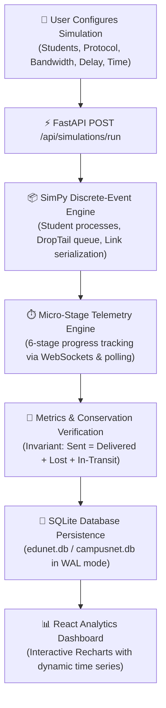

<div align="center">

# 🎓 CampusNet Analyzer
### University Campus E-Learning Network Performance Simulator
#### Discrete-Event Simulation, Protocol Modeling & Performance Telemetry Suite

[](https://fastapi.tiangolo.com)
[](https://reactjs.org)
[](https://simpy.readthedocs.io)
[](https://tailwindcss.com)
[](https://sqlite.org)

<p align="center">
  <b>Simulate. Measure. Compare. Optimize.</b><br>
  <i>An educational discrete-event network simulation platform engineered for Computer Networks, Protocol Engineering, and Performance Analysis laboratories.</i>
</p>

[📌 Problem Statement](#-problem-statement) •
[🏛️ Campus Topology](#-university-e-learning-topology) •
[⚡ Discrete-Event Architecture](#-discrete-event-simulation-architecture) •
[🔄 Protocol Models](#-educational-protocol-models) •
[📊 Verified Metrics](#-verified-performance-metrics) •
[🚀 Quick Start](#-quick-start-guide) •
[🐳 Docker Setup](#-docker-deployment) •
[📄 College Report](docs/PROJECT_REPORT.md) •
[🚀 Deployment](docs/DEPLOYMENT.md) •
[⚠️ Scope & Limitations](#-scope--educational-limitations)

---

</div>

## 📌 Problem Statement

During peak academic periods (such as live remote examinations, synchronized video lectures, and deadline submissions), hundreds of university students concurrently access central campus digital infrastructure (LMS, lecture streaming servers, examination portals).

Contention across constrained gateway links produces severe network degradation:
- Buffer overflow at bottleneck routers resulting in packet drops
- Uncontrolled UDP streams starving latency-sensitive interactive sessions
- Excessive queuing delays inflating end-to-end round-trip times
- Collapse of effective application throughput (goodput)

**CampusNet Analyzer** simulates, records, and visualizes the exact discrete-event packet dynamics of this campus e-learning network. It allows students and instructors to model diverse student concurrency levels, compare transport protocols (TCP vs UDP), analyze sliding-window flow control (Go-Back-N), evaluate traffic shaping mechanisms (Leaky Bucket), and defend performance metrics with verifiable mathematical conservation.

---

## 🏛️ University E-Learning Topology

The university e-learning network is modeled as a tiered campus architecture:
- **$N$ Student Workstation Nodes**: University client machines running e-learning applications (configurable from 1 to 250 concurrent students).
- **Access Router ($R_1$)**: Aggregates traffic from the student subnet over high-speed access links (10 Mbps, 5 ms delay).
- **Bottleneck Campus Gateway Link**: Constrained connection between Access Router $R_1$ and Core Router $R_2$ representing campus gateway bandwidth limits (configurable from 256 Kbps to 5 Mbps, 20 ms delay, DropTail bounded queue).
- **Core Router ($R_2$)**: Distributes campus backbone traffic to data center resources.
- **LMS Central Server**: Target destination with a 100 Mbps uplink hosting lecture video feeds, quizzes, and learning materials.

```
┌────────────────────────────────────────────────────────────────────────────────────────────────┐
│                                 CAMPUS E-LEARNING TOPOLOGY                                    │
│                                                                                                │
│  [Student 0] ───┐                                                                             │
│  [Student 1] ───┤ 10 Mbps                                Bottleneck Link                      │
│  [Student 2] ───┼────────► [ Access Router R1 ] ════════════════════════► [ Core Router R2 ]  │
│  [Student ..]───┤   5 ms                         Bandwidth: 512Kbps-5Mbps          │          │
│  [Student N] ───┘                                Delay: 20 ms                      │ 100 Mbps │
│                                                  Queue: DropTail (Bounded)         │   2 ms   │
│                                                                                    ▼          │
│                                                                           [ LMS Central Server]│
└────────────────────────────────────────────────────────────────────────────────────────────────┘
```

---

## ⚡ Discrete-Event Simulation Architecture

CampusNet Analyzer uses **SimPy** as its primary, native discrete-event simulation engine (`SimPySimulationEngine`). It executes natively on Windows, Linux, and macOS without requiring external simulator binaries, compilers, or virtualization.



### Execution Modes
1. **🟢 Real-Time Mode (SimPy Discrete-Event Simulation — Default)**:
   - Executes the authentic SimPy discrete-event simulation engine in real time.
   - Emits live 6-stage telemetry (`initialized` → `generating_traffic` → `simulating_queue` → `processing_metrics` → `saving_results` → `completed`).
   - Persists all experiment parameters, summary metrics, and 1-second time-series logs directly into SQLite.
2. **🟦 Demo Mode (Calibrated Sample Reference Data)**:
   - Operates 100% offline using pre-calibrated laboratory sample records (DEMO-001 through DEMO-009).
   - Designed for instant exploration, classroom presentations, or testing when backend execution is not active.
3. **Optional Legacy NS-2 Integration**:
   - NS-2 is maintained as an optional, secondary historical mode. If native NS-2 or WSL2 Ubuntu NS-2 is installed on the host, the system can detect it; however, **NS-2 is not required** for normal operation.

---

## 🔄 Educational Protocol Models

CampusNet Analyzer implements faithful educational models for core networking mechanisms:

### 1. TCP AIMD Congestion Control (NewReno-Style)
- **Slow Start**: Congestion window ($cwnd$) doubles every round-trip time until reaching the slow-start threshold ($ssthresh$).
- **Congestion Avoidance (Additive Increase)**: $cwnd$ expands linearly by 1 packet per RTT ($cwnd \leftarrow cwnd + 1/cwnd$ per ACK).
- **Fast Retransmit & Multiplicative Decrease**: Upon detecting packet drop, $ssthresh \leftarrow \max(2, cwnd / 2)$ and $cwnd \leftarrow ssthresh$.

### 2. UDP CBR (Constant Bit Rate)
- Transmits packets at regular intervals determined by the offered data rate without flow control or backoff.
- Demonstrates how unresponsive UDP streams cause queue starvation and high drop rates under constrained bandwidth.

### 3. Go-Back-N Sliding Window ARQ
- Implements a sender sliding window of size $N$ with cumulative acknowledgments and timeout-driven retransmission.
- Traces sequence number evolution, highlighting the characteristic saw-tooth retransmission pattern upon packet loss.

### 4. Leaky Bucket Traffic Shaper
- Smooths bursty traffic streams by admitting packets into a bounded bucket and releasing them onto the network at a constant, uniform leak rate.
- Directly demonstrates how traffic shaping prevents queue overflow at downstream bottleneck links.

---

## 📊 Verified Performance Metrics

CampusNet Analyzer strictly adheres to standard academic networking formulas and maintains clear distinctions across packet accounting levels:

### Documented Formulas & Distinctions:
1. **Throughput / Goodput (Kbps)**:
   $$\text{Throughput} = \frac{\text{Unique Delivered Payload Bytes} \times 8}{\text{Observation Duration (s)} \times 1000}$$
2. **Terminal Packet Loss (%)**:
   $$\text{Packet Loss} = \frac{\text{Unique Lost Packets}}{\text{Unique Generated Packets}} \times 100$$
   *Note: In reliable protocols like TCP, dropped transmission attempts are retransmitted; terminal packet loss measures unique packets never delivered.*
3. **Physical Drop Events**:
   Total number of packet transmission attempts rejected by the bottleneck queue due to buffer overflow.
4. **Packet Delivery Ratio (PDR %)**:
   $$\text{PDR} = \frac{\text{Unique Delivered Packets}}{\text{Unique Generated Packets}} \times 100$$
5. **Average End-to-End Delay (ms)**:
   Arithmetic mean of queuing, serialization, and propagation delays across all successfully delivered packets.
6. **Strict Conservation Invariant**:
   $$\text{Unique Sent} = \text{Unique Delivered} + \text{Unique Lost} + \text{In-Transit}$$

---

## 🚀 Quick Start Guide

### Prerequisites
- **Python 3.10+** (Python 3.11 recommended)
- **Node.js 18+** and npm
- **Windows 10/11**, **Linux**, or **macOS**

### Option A: One-Click Launch (Windows)
Double-click `start.bat` in the project root:
```powershell
.\start.bat
```
This batch script automatically validates your Python virtual environment, installs backend and frontend dependencies, launches both services, and opens the application in your browser.

---

### Option B: Manual Setup

#### 1. Backend Setup
```bash
# Navigate to backend directory
cd backend

# Create and activate virtual environment
python -m venv venv
# On Windows:
.\venv\Scripts\activate
# On Linux/macOS:
source venv/bin/activate

# Install dependencies
pip install -r requirements.txt

# Start FastAPI backend server
uvicorn app.main:app --host 127.0.0.1 --port 8000 --reload
```
- API Swagger Docs: `http://127.0.0.1:8000/docs`
- Healthcheck: `http://127.0.0.1:8000/api/health`
- Simulator Status: `http://127.0.0.1:8000/api/system/status`

#### 2. Frontend Setup
```bash
# In a new terminal, navigate to frontend directory
cd frontend

# Install dependencies
npm install

# Start Vite development server
npm run dev
```
Open `http://localhost:5173` in your browser.

---

## 🐳 Docker Deployment

CampusNet Analyzer provides a complete multi-container setup with persistent SQLite storage:

```bash
# Build and run containers
docker-compose up -d --build
```

- **Frontend SPA**: `http://localhost:5173` (or `http://localhost`)
- **Backend API**: `http://localhost:8000`
- **Data Persistence**: A dedicated Docker volume `campusnet_backend_data` ensures experiment history is safely preserved across container restarts.

To stop:
```bash
docker-compose down
```

---

## 💾 SQLite Database & Backup Instructions

CampusNet Analyzer exclusively utilizes **SQLite** with high-concurrency production tuning:
- **Zero External DB Dependencies**: Strictly uses SQLite without requiring PostgreSQL, MySQL, or MongoDB.
- **Write-Ahead Logging (WAL)**: `PRAGMA journal_mode=WAL` allows simultaneous concurrent readers while simulation workers persist metrics.
- **Non-Blocking Timeouts**: `PRAGMA busy_timeout=5000` (5-second lock queue) and SQLAlchemy connection timeout of `30.0s`.
- **Git Protection**: All SQLite database files (`*.db`, `*.db-shm`, `*.db-wal`) are strictly ignored by `.gitignore`.

### Local Database Backup & Restore Guide:

#### 1. Create a Safe Point-in-Time Backup:
Using the SQLite online backup API ensures safe point-in-time copying even while simulations are running:
```bash
# Using sqlite3 CLI
sqlite3 backend/edunet.db ".backup backend/backup_snapshot.db"

# Or on Windows PowerShell:
# Copy the primary file when simulations are idle:
Copy-Item backend/edunet.db backend/backup_snapshot.db
```

#### 2. Restore from Backup:
```bash
# Stop backend server, then restore:
cp backend/backup_snapshot.db backend/edunet.db

# Or on Windows PowerShell:
Copy-Item backend/backup_snapshot.db backend/edunet.db -Force
```

---

## 🎨 Modern UI/UX Redesign & Frontend Architecture

The frontend is built with React 18, TypeScript, Tailwind CSS v3, and Recharts, featuring a comprehensive design system:

| Page | Route | Description |
|---|---|---|
| **Executive Dashboard** | `/` | Real-time KPI stat cards, system status ribbon, 8 interactive Recharts visualizations |
| **New Simulation** | `/simulate` | Workload tier presets (Low/Medium/High/Custom), TCP/UDP radio cards, academic benchmark profile |
| **Simulation Monitor** | `/monitor` | 6-stage telemetry stepper, live console log terminal, WebSocket with auto polling fallback |
| **Experiment Results** | `/experiments/:id` | Detailed metric cards, mathematical conservation audit, second-by-second time series, CSV/PDF exports |
| **TCP vs UDP Comparison** | `/tcp-udp` | Protocol architecture battle cards, multi-rate progression benchmarks (256K to 5M) |
| **Experiment Comparison** | `/compare` | Multi-experiment comparative matrix (up to 4 runs), delta variances, automated rule-based analysis |
| **Experiment History** | `/experiments` | Keyword search, protocol and scenario filters, batch multi-select, CSV/PDF actions |
| **Sliding Window Visualizer**| `/sliding-window` | Interactive frame sequence buffer, bi-directional channel animation, RTO timeout simulation |
| **Go-Back-N ARQ** | `/go-back-n` | Cumulative acknowledgment simulation, sender window rewinding, out-of-order frame discard |
| **Leaky Bucket** | `/leaky-bucket` | Fluid dynamic buffer visualizer, burst injection, shaped vs unshaped throughput dynamics |
| **Performance Analysis** | `/performance` | Student concurrency scaling (10 to 200 nodes), bottleneck queue saturation threshold |
| **Network Topology** | `/topology` | Interactive 4-tier SVG campus topology diagram, clickable node inspector, queue overflow indicator |
| **Report Hub** | `/reports` | Academic report standard structure guide, direct CSV and publication-ready PDF downloads |
| **Diagnostics & Settings** | `/settings` | 6-card system diagnostics, SQLite WAL telemetry, clean reset tool, backup instructions |

---

## 🧪 Automated Testing

CampusNet Analyzer includes extensive verification test suites covering the SimPy simulation engine, API endpoints, telemetry lifecycle, and frontend interfaces:

```bash
# Run backend test suite (Python / pytest)
pytest backend/tests/test_backend.py backend/tests/test_simpy_engine.py backend/tests/test_phase_3a_integration.py backend/tests/test_phase_3b_api.py backend/tests/test_phase_3d_stabilization.py -v

# Run frontend test suite (Node test runner)
cd frontend
npm test

# Verify TypeScript compilation
npx tsc --noEmit

# Run end-to-end integration benchmark
python backend/tests/verify_e2e_frontend_backend.py
```

---

## ⚠️ Scope & Educational Limitations

CampusNet Analyzer is an **educational network simulation platform** designed for computer science laboratory coursework, protocol analysis, and viva defense demonstrations:

- **Intended Purpose**: Visualizing queue contention, packet drops, sliding window dynamics, and protocol trade-offs under varying concurrency levels.
- **Queue Model**: Bounded DropTail FIFO queue modeling buffer overflow at the campus gateway.
- **Transport Models**: Simplified educational state machines for TCP AIMD (congestion window evolution, additive increase, multiplicative decrease) and UDP CBR.
- **Not a Kernel TCP/IP Stack**: Does not implement raw socket packet manipulation, complete RFC-compliant TCP option headers (SACK, timestamps), or BGP/OSPF dynamic routing.
