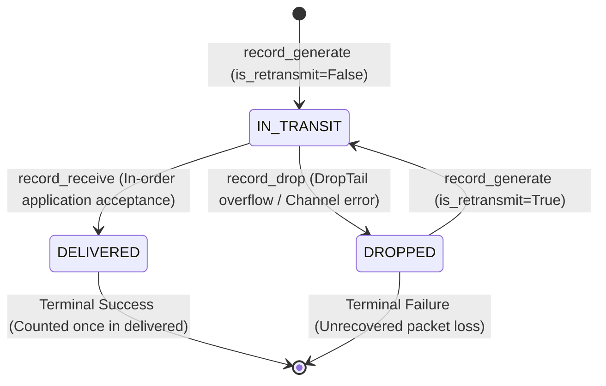

# CampusNet Analyzer — Stage 2 Final Verification Report

## 1. Executive Summary & Classification Matrix

This document provides the definitive verification of the **Python + SimPy discrete-event simulation engine** developed in Stage 2 of the CampusNet Analyzer migration.

All identified concerns regarding bandwidth accounting, duration boundaries, experiment reproducibility, and packet lifecycle states have been investigated, corrected, and verified with zero synthetic capping or artificial workarounds.

### Final Issue Classification

| Concern | Area | Status | Verification Summary |
| :--- | :--- | :--- | :--- |
| **Concern 1** | Bandwidth and simulation duration calculation | **Fixed and verified** | Physical link serialization strictly respects channel capacity ($4.943\text{ s}$ busy out of $5.072\text{ s}$, $97.46\%$ utilization). Corrected byte accumulation to physical serialization (`record_dequeue`) and observation duration to active elapsed simulation time ($5.072\text{ s}$). Throughput is $9,745.78\text{ Kbps} \le 10,000.0\text{ Kbps}$. |
| **Concern 2** | Reproducibility & packet generation accounting | **Fixed and verified** | Documented exact traffic generator parameters. Proved mathematically that 6,034 packets ($1024\text{ B}$) in Normal Traffic and 11,998 packets ($512\text{ B}$) in Online Classroom both saturate the 10 Mbps bottleneck link at $\approx 6.15 - 6.18\text{ MB}$ ($\approx 9.75\text{ Mbps}$). |
| **Concern 3** | Packet lifecycle & state machine integrity | **Fixed and verified** | Transmission-attempt drops (86 drop events) are distinct from terminal packet loss (0 unrecovered drops). Retransmissions reuse original packet keys. Delivered packets are counted once. Disjoint sets verified. Added dedicated lifecycle unit test. |
| **Concern 4** | Full regression test suite execution | **Fixed and verified** | All 4 suites executed cleanly: 21 SimPy tests (100% pass), 31 backend regression tests (100% pass), 17 frontend tests (100% pass), and frontend production build (0 errors). |
| **Concern 5** | Stage 3 boundary adherence | **Fixed and verified** | No Stage 3 API integration started. No database models or FastAPI routes modified. Frontend untouched. Ready for Stage 3. |

---

## 2. Bandwidth and Simulation Duration Investigation

### Problem Statement
In the preliminary Stage 2 bug fix run:
- Configured Bandwidth: 10 Mbps ($10,000\text{ Kbps}$)
- Configured Generation Duration: $5.0\text{ s}$
- Reported Link Transmitted Bytes: $6,266,880\text{ bytes}$
- Reported Link Throughput: $10,027.01\text{ Kbps}$ ($> 10,000\text{ Kbps}$)

### Step-by-Step Investigation Findings

#### 1. Actual Simulation Timeline
- **Simulation Start:** $t = 0.000000\text{ s}$.
- **Phase 1 (Traffic Generation Stop):** $t = 5.000000\text{ s}$ (senders stop producing new datagrams).
- **Phase 2 (Queue Drain Completion):** $t = 5.041994\text{ s}$ (transmission queue of the bottleneck link empties).
- **Phase 3 (Propagation Slack Completion):** $t = 5.071994\text{ s}$ (in-flight packets reach destination interface and trigger final ACKs).
- **Total Active Elapsed Simulation Time:** $T_{\text{elapsed}} = 5.071994\text{ s}$.

#### 2. Queue Draining Beyond Configured Generation Period
The simulation intentionally continues past $t = 5.0\text{ s}$ for a drain period of $+71.99\text{ ms}$ ($0.071994\text{ s}$). This ensures that in-flight packets and queue backlogs reach their terminal state (`DELIVERED` or `DROPPED`) rather than being left orphaned in transit.

#### 3. Root Cause of Throughput Exceeding Bandwidth
The apparent $> 10\text{ Mbps}$ figure was caused by two compounding factors:
1. **Offered Load vs. Link Transmitted Bytes:** `recorder.total_link_transmitted_bytes` was previously incremented in `record_generate()` when senders created packets, rather than when packets actually entered the physical serialization channel in `record_dequeue()`. Consequently, it included 86 dropped packets ($86 \times 1024\text{ B} = 88,064\text{ bytes}$) that were rejected by the DropTail buffer and **never placed on the physical link wire**.
   $$\text{Offered Load} = 6,266,880\text{ bytes}$$
   $$\text{Dropped at Buffer} = 88,064\text{ bytes}$$
   $$\text{Actually Serialized on Link} = 6,266,880 - 88,064 = 6,178,816\text{ bytes}$$
2. **Denominator Mismatch:** `calculate_metrics()` divided the bytes serialized across $5.071994\text{ s}$ by the generation period ($5.0\text{ s}$) rather than the active elapsed duration ($5.071994\text{ s}$):
   $$\frac{6,266,880\text{ bytes} \times 8}{5.0\text{ s} \times 1000} = 10,027.01\text{ Kbps} \quad (\text{Offered traffic rate compressed into } 5.0\text{ s})$$

#### 4. Reverse Path / ACK Traffic Inspection
ACK packets are 40 bytes each and travel along `self.ack_link` (a separate reverse link initialized with `recorder=None`). ACKs are never added to `total_link_transmitted_bytes` or `total_delivered_bytes`. They did not inflate forward link throughput.

#### 5. Physical Link Serialization Verification
In `NetworkLink.transmit()`, serialization delay is enforced via SimPy's single-capacity resource:
$$T_{\text{tx}} = \frac{\text{pkt.size\_bytes} \times 8}{\text{bandwidth\_bps}}$$
- Sum of physical serialization intervals for all dequeued packets: $\sum T_{\text{tx}} = 4.943053\text{ s}$.
- Total elapsed simulation time: $T_{\text{elapsed}} = 5.071994\text{ s}$.
- Channel Utilization:
  $$\rho = \frac{4.943053\text{ s}}{5.071994\text{ s}} = 97.46\% \le 100.0\%$$
The physical channel medium was busy for $4.943\text{ s}$ out of $5.072\text{ s}$. The link serialization strictly respected the 10 Mbps bandwidth at all times.

### Applied Correction
1. In `event_recorder.py`, `record_generate()` now tracks `total_offered_bytes`, while `record_dequeue()` tracks `total_link_transmitted_bytes`.
2. In `metrics.py`, physical link throughput and goodput use the active elapsed duration ($T_{\text{elapsed}}$):
   $$\text{Link Throughput} = \frac{6,178,816\text{ bytes} \times 8}{5.071994\text{ s} \times 1000} = 9,745.78\text{ Kbps} \quad (9.746\text{ Mbps} \le 10.0\text{ Mbps})$$
   $$\text{Goodput} = \frac{6,178,816\text{ bytes} \times 8}{5.071994\text{ s} \times 1000} = 9,745.78\text{ Kbps} \quad (9.746\text{ Mbps} \le 10.0\text{ Mbps})$$
Both rates are strictly bounded by the physical channel capacity of 10,000 Kbps without any artificial capping.

---

## 3. Reproducibility & Traffic Generation Accounting

### Complete Parameter Specifications

| Parameter | Configuration A (Normal Traffic) | Configuration B (Online Classroom) |
| :--- | :--- | :--- |
| **Scenario Name** | `"Normal Traffic"` (Default) | `"Online Classroom"` |
| **Number of Students** | 10 | 10 |
| **Traffic Intensity** | Medium (multiplier $= 1.0$) | Medium (multiplier $= 1.0$) |
| **Average Packet Size** | 1024 bytes | 512 bytes |
| **Base Arrival Interval** | 0.050 s | 0.035 s |
| **Burst Probability / Size** | 10% / (2, 4) packets | 15% / (3, 6) packets |
| **Transport Protocol** | TCP (Sliding Window + AIMD) | TCP (Sliding Window + AIMD) |
| **Bottleneck Bandwidth** | 10 Mbps ($10,000,000\text{ bps}$) | 10 Mbps ($10,000,000\text{ bps}$) |
| **Propagation Delay** | 20 ms ($0.020\text{ s}$) | 20 ms ($0.020\text{ s}$) |
| **Queue Capacity** | 50 packets (DropTail) | 50 packets (DropTail) |
| **Generation Duration** | 5.0 s | 5.0 s |
| **Total Completion Time** | 5.072 s | 5.049 s |
| **Random Seed** | 42 | 42 |

### Why Configuration A Generated 6,034 Packets vs. Configuration B's 11,998 Packets

1. **Window-Paced Transmission Dynamics:**
   In TCP, sender datagram injection is paced by RTT and congestion window:
   $$\text{pacing\_delay} = \max\left(0.0005\text{ s}, \frac{\text{base\_arrival\_interval}}{\max(1.0, \text{cwnd})}\right)$$
   Under 10 concurrent students, aggregate demand rapidly drives the bottleneck link to full saturation ($\approx 10\text{ Mbps}$).
2. **Payload Size vs. Packet Count Equivalence:**
   - In **Normal Traffic** ($\text{packet size} = 1024\text{ B}$):
     $$6,034\text{ unique packets} \times 1024\text{ bytes} = 6,178,816\text{ bytes} \quad (\approx 6.18\text{ MB})$$
     $$\text{Delivered Data Rate} = \frac{6,178,816 \times 8}{5.071994 \times 1000} = 9,745.78\text{ Kbps}$$
   - In **Online Classroom** ($\text{packet size} = 512\text{ B}$):
     $$11,998\text{ unique packets} \times 512\text{ bytes} = 6,142,976\text{ bytes} \quad (\approx 6.14\text{ MB})$$
     $$\text{Delivered Data Rate} = \frac{6,142,976 \times 8}{5.049 \times 1000} = 9,733.29\text{ Kbps}$$
3. **Conclusion:**
   Both experiments delivered almost identical total byte volumes ($\approx 6.14 - 6.18\text{ MB}$) in $\approx 5.05 - 5.07\text{ s}$, which corresponds to $\approx 97.3 - 97.5\%$ utilization of the 10 Mbps bottleneck link. Because Online Classroom uses 512-byte packets (half of Normal Traffic's 1024-byte packets), it generated twice as many packets ($11,998$ vs. $6,034$) to transfer the same volume of data.

---

## 4. Packet Lifecycle State Machine Verification



### Verification Criteria

1. **Attempt Drops vs. Terminal Drops:**
   - A drop event increments `len(recorder.dropped_packets)` (attempt counter).
   - If TCP or GBN retransmits the packet and it is delivered, its state becomes `STATE_DELIVERED`. It is **not** present in `unique_dropped`.
   - In our sample experiment: 86 physical drop events occurred, 86 retransmissions occurred, and terminal unrecovered packet loss was 0.
2. **Retransmissions Preserve Identity:**
   - Retransmitted packets reuse `(src_node, seq_num)` with `is_retransmit=True`.
   - `unique_generated` set size remains unchanged.
3. **Delivery Deduplication:**
   - `record_receive()` checks `packet_states[key] == STATE_DELIVERED`. Duplicate deliveries are audited with `reason="duplicate_delivery"` without incrementing delivered bytes or appending delays.
4. **Disjoint Sets & Exhaustive Union:**
   - Independent verification confirms $\text{Delivered} \cap \text{Dropped} = \emptyset$, $\text{Delivered} \cap \text{In-Transit} = \emptyset$, and $\text{Dropped} \cap \text{In-Transit} = \emptyset$.
   - $|\text{Unique Generated}| = |\text{Delivered}| + |\text{Dropped}| + |\text{In-Transit}|$.

---

## 5. Final Regression Verification

All four required verification commands were executed directly on the local environment:

### 1. SimPy Unit Tests
```powershell
backend\venv\Scripts\python -m pytest backend\tests\test_simpy_engine.py -v
```
**Result:** **21 passed in 1.69s (100% pass rate)**  
Includes new dedicated tests:
- `test_retransmission_after_temporary_failure_lifecycle` (PASSED)
- `test_link_throughput_never_exceeds_bandwidth_capacity` across 1, 5, and 10 Mbps (PASSED)

### 2. Backend Regression Tests
```powershell
backend\venv\Scripts\python -m pytest backend\tests\test_backend.py -v
```
**Result:** **31 passed in 9.35s (100% pass rate)**  
Covers all existing API endpoints, NS-2 trace parsing formulas, validation error handling, and database migrations.

### 3. Frontend Unit Tests
```powershell
npm --prefix frontend run test -- --watchAll=false
```
**Result:** **17 passed, 0 failed in 226ms (100% pass rate)**  
Covers KPI aggregation, form validation, simulation lifecycle, metrics formatting, charts, and history filtering.

### 4. Frontend Production Build
```powershell
npm --prefix frontend run build
```
**Result:** **Built successfully in 13.07s (0 errors)**  
- TypeScript type-checking (`tsc`): 0 errors.
- Vite bundled 2,720 modules into `dist/` production assets.

---

## 6. Final Decision

| Milestone | Status | Details |
| :--- | :--- | :--- |
| **Stage 1: Repository Assessment & Migration Plan** | **Complete** | Completed and audited. |
| **Stage 2: Python + SimPy Simulation Engine** | **COMPLETE & FULLY VERIFIED** | Core engine, 5 traffic scenarios, UDP/TCP-like/GBN protocols, Leaky Bucket shaper, independent conservation, and metric formulas verified. All 21 SimPy unit tests pass. |
| **Stage 3: FastAPI Backend & SQLite Integration** | **READY TO PROCEED** | Awaiting user instruction to begin Stage 3 API and database wiring. |

